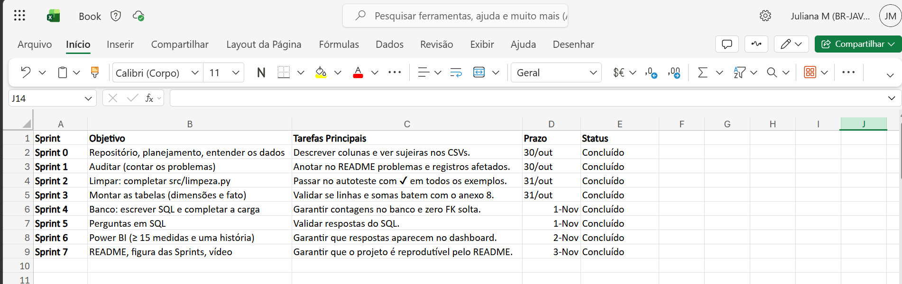

# 📊 Controle e Análise de Compras Públicas (PNCP) - Esteira Analítica

Este projeto apresenta uma Solução de Business Intelligence desenvolvida para a **Controladoria**, visando monitorar, analisar e auditar contratações públicas baseadas nos dados do Portal Nacional de Contratações Públicas (PNCP). O projeto consolida a jornada ponta a ponta (End-to-End) de uma esteira analítica: desde a extração e higienização de dados brutos corrompidos até a modelagem relacional e a construção de um dashboard executivo.

Projeto desenvolvido como entrega final do Módulo 2 do curso de **Análise de Dados (SENAI SCTEC)**.

---

## 🎯 Contexto e Desafio
A Controladoria identificou gargalos operacionais nas contratações públicas: indícios de sobrepreço, concentração em grupos econômicos e morosidade. Como os sistemas legados não possuem travas de validação, a base de dados apresentava severas anomalias estruturais. O desafio foi criar um ambiente analítico confiável, auditável e executivo a partir de uma base com milhares de registros referentes ao ano de 2025.

---

## 🛠️ Tecnologias e Decisões Técnicas
* **VS Code (com Python & Pandas):** Ambiente de desenvolvimento utilizado para auditar, higienizar e tratar todas as anomalias da base de dados através de scripts automatizados.
* **MySQL:** Banco de dados relacional escolhido para armazenar os dados limpos, garantindo a integridade referencial através de constraints e modelagem dimensional em Star Schema.
* **Power BI:** Ferramenta de Business Intelligence utilizada para construir a camada visual do projeto (Dashboard), utilizando tabelas Calendário dinâmicas, 15+ medidas avançadas em DAX e recursos de UX (Tooltips, Bookmarks).
* **Excel (Gestão Ágil):** Utilizado para o planejamento visual e acompanhamento das Sprints, garantindo entregas incrementais.
* **Git e GitHub:** Controle de versionamento para garantir o histórico seguro do código e a disponibilização pública do portfólio.

---

## 📅 Planejamento em Sprints
O projeto foi estruturado e executado de forma iterativa através do planejamento visual abaixo:

---

## 🧹 Tratamento de Dados e Inconsistências (Dicionário)
Durante o processamento em Python, os seguintes tratamentos foram documentados e executados nas bases `compras.csv`, `itens.csv` e `resultados.csv`:
1. **Documentos (CNPJ/CPF):** Remoção de máscaras e formatação padronizada para identificar corretamente unidades compradoras e fornecedores (correção de perda de zeros à esquerda).
2. **Moedas e Decimais:** Higienização de strings corrompidas, remoção de cifras (R$), tratamento de vírgulas e pontos para adequação ao padrão numérico.
3. **Datas e Cronologia:** Conversão para formato `DATE`. Identificação de violações lógicas (itens com data de homologação anterior à publicação do edital) para não distorcer o ciclo de compras.
4. **Nulos Disfarçados:** Remoção de strings vazias mascaradas como "N/A", "NULL", "-", "0" (em campos de texto) ou "SEM INFORMAÇÃO".
5. **Regras de Negócio de Descarte:** Rejeição de itens com valores sigilosos, quantidades vazias/negativas, divergências absurdas e descarte de atas de Registro de Preços canceladas.

---

## 🗄️ Modelagem Dimensional (Star Schema)
O banco de dados foi estruturado para otimizar as consultas analíticas, segregando os fatos das suas descrições:
* **Fato:** `fato_item_contratado` (Granularidade: 1 linha por item homologado com vencedor).
* **Dimensões:** `dim_orgao` (Quem comprou), `dim_fornecedor` (Quem vendeu), `dim_modalidade` (Como comprou), `dim_localidade` (Onde comprou).
* *A integridade foi garantida via chaves primárias e estrangeiras. A dimensão de Tempo (Calendário) foi gerada virtualmente via DAX no Power BI.*

---

## 🚀 Como Executar o Projeto (Guia de Reprodução)
Para reproduzir este ambiente na sua máquina:
1. Clone este repositório via terminal: `git clone https://github.com/Juyuria/Esteira-Analitica-PNCP-Sctec.git`
2. Na raiz do projeto, instale as dependências.
3. Execute as rotinas Python (`src/limpeza.py` e `src/montar_tabelas.py`) para gerar os dados tratados.
4. Abra o MySQL Workbench e execute o script `sql/01_criar_banco.sql` para instanciar as tabelas.
5. Rode `src/carregar.py` para efetuar a ingestão automatizada no banco de dados.
6. Abra `powerbi/dashboard_pncp.pbix` no Power BI Desktop para visualizar o Dashboard interativo.

---

## 🔮 Melhorias Futuras
Como próximos passos para escalabilidade da solução analítica:
* **Migração Cloud:** Migrar os scripts locais de Python e o banco de dados on-premise para um ecossistema Cloud (AWS), utilizando ferramentas como AWS Glue e RDS.
* **Atualização Incremental:** Configurar atualizações diárias automáticas consumindo diretamente a API oficial do PNCP, garantindo visão "D-1" dos processos.

---

## 🔗 Links e Entregáveis
* 🗂️ **Download do Dashboard Power BI:** [dashboard_pncp.pbix](./powerbi/dashboard_pncp.pbix)
* 🎥 ** **Vídeo de Defesa (Review de Sprint):** [Assistir Vídeo no OneDrive](https://onedrive.live.com/photos?photosData=%2Fshare%2F814AAAD8EF4B35E0%21s441d6181b7674b689536607fe26771ce%3Fithint%3Dvideo%26e%3DoChFVn%26migratedtospo%3Dtrue&redeem=aHR0cHM6Ly8xZHJ2Lm1zL3YvYy84MTRhYWFkOGVmNGIzNWUwL0lRQ0JZUjFFWjdkb1M1VTJZSF9pWjNIT0FZbHg4QkVSUy04c25EQkg5YlpVcDA0P2U9b0NoRlZu)
---
**Desenvolvida por:** Juliana Matsuda  
*Desenvolvedora de Software & Analista de Dados | Estudante de ADS, Análise de Dados e AWS Cloud*
